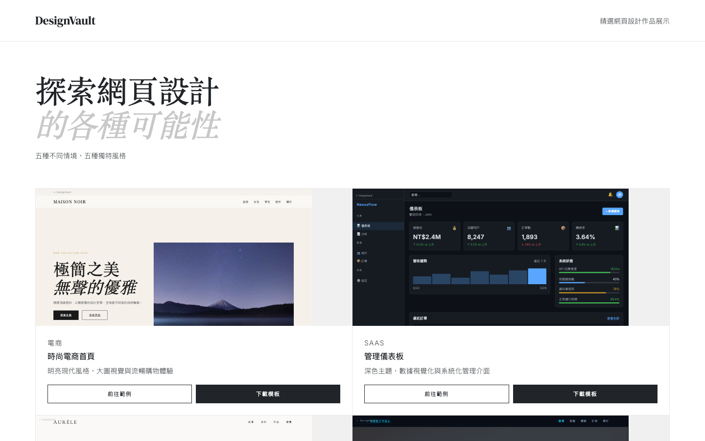

<!-- 本檔由 /sync-docs 自動生成，請勿手動編輯——手改內容下次會被覆蓋。 -->
# DesignVault

精選網頁設計作品展示 — 純靜態前端作品集，包含五個網頁設計 Demo，無任何框架或建置流程。



## 作品列表

| Demo | 品牌名稱 | 主題風格 |
|---|---|---|
| [Fashion E-Commerce](pages/fashion-ecommerce/) | MAISON NOIR | 時尚電商，暖色調 |
| [SaaS Dashboard](pages/saas-dashboard/) | NexusFlow Enterprise | 深色系分析儀表板 |
| [Boutique Brand](pages/boutique-brand/) | AURÈLE | 極簡奢華品牌形象 |
| [Space Hotel](pages/space-scifi/) | ORBITAL | 太空主題豪華飯店 |
| [AI Writing Tool](pages/quill-landing/) | Quill | SaaS 行銷落地頁 |

## 技術棧

- HTML5 / CSS3 / Vanilla JavaScript（無框架、無套件管理器）
- Bootstrap 5.3.3（CDN）
- Google Fonts（各 Demo 各自載入）
- 首頁「下載模板」以 JSZip 在瀏覽器端打包；各 Demo 內建 `api-guide.js` 列出預期串接的 API endpoints
- 部署：GitHub Pages（`.github/workflows/deploy.yml`）

## 快速開始

```bash
python3 -m http.server 8080
```

瀏覽 `http://localhost:8080` 即可看到首頁。完整開發說明見 [docs/dev.md](docs/dev.md)。

## 目錄結構

| 路徑 | 用途 |
|---|---|
| `index.html` | 首頁，列出所有 Demo |
| `css/style.css` | 首頁全域樣式 |
| `js/main.js` | 下載 ZIP 邏輯 |
| `pages/<demo>/` | 各 Demo（`custom.css`、`api-guide.js`、`index.html` 與子頁） |
| `docs/` | 開發文件、設計 spec 與計畫 |
| `.github/workflows/` | GitHub Pages 部署 |
